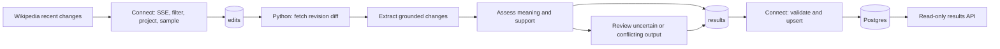

# Handover and assignment checklist

Begin with the [simple operator guide](operations.md). The supported deployment is a single local Docker stack with selectable Ollama/OpenAI inference. The scripts and tests are designed for review and recovery; 100% unit coverage is not a claim of perfect models, gap-free upstream delivery, or a production hosting platform.

## Follow one edit

Connect discards bots and non-article/non-English edits, projects only necessary fields, then selects a deterministic 1% by event identity. The worker fetches the actual before/after revision comparison from the fixed Wikipedia API endpoint. It extracts exact quoted changes, assesses their meaning and evidence, and may request a second assessment. Validation, four-call and time budgets are shared across repairs/retries. Unavailable evidence produces abstention; technical failures produce explicit error records. A result is a suggestion for human review, not a claim of factual truth or an automatic Wikipedia action.

Output acknowledgement precedes input offset commit. A crash between them can repeat inference and publish duplicate results. Connect persists only valid envelopes; a unique `(wiki, revision_id, analysis_version)` key and monotonic source offset preserve one logical SQL row. This assumes a single results partition and stable topic history; do not delete/recreate the topic while retaining its database and assume offsets remain comparable. Reset broker and database together with the documented data-cleanup command when discarding the demo.

## Code map

| Question | Read |
|---|---|
| What comes in and what is discarded? | `connect/ingest.yaml`, `connect/ingest_test.yaml` |
| What are the contracts and bounds? | `src/triage/schema.py`, `src/triage/enrichment.py`, `schemas/` |
| How is an HTML revision diff parsed safely? | `src/triage/diff.py` |
| What does the model see and how is it validated? | `src/triage/prompts.py`, `src/triage/reasoning.py`, `src/triage/llm.py` |
| When are offsets committed? | `src/triage/broker.py`, `src/triage/worker.py` |
| How are results deduplicated and served? | `connect/sink.yaml`, `db/002-results.sql`, `src/triage/storage.py`, `src/triage/api.py` |
| How do model tests and cleanup work? | `src/triage/evaluation.py`, `src/triage/operations.py`, thin wrappers in `scripts/` |
| Where are recovery proofs? | `tests/test_worker_integration.py`, `tests/test_serving_integration.py`, `tests/test_acceptance_integration.py` |

## Assignment requirements

| Original requirement | Delivered proof / remaining work |
|---|---|
| Public free source requiring no authentication | Wikimedia recent-change stream and revision API; live checks and attributed fixture |
| Redpanda Connect selects and transforms data | Native SSE/filter/projection/routing pipeline, 40 ingestion cases, real broker integration |
| Worker in chosen language using a local model | Python, bundled Ollama by default; optional explicit OpenAI profile |
| Reasoning depends on actual content | Revision enrichment plus grounded extraction → assessment → optional review; nine frozen acceptance cases per provider |
| More than a single prompt invocation | Ready successful examples have at least extraction and assessment calls; review/repair paths tested |
| Dirty output and uncertainty handled | Strict JSON/quotes/enums, shared retry budget, abstention and error topics; deterministic negative cases |
| Structured/enriched output consumed downstream | Versioned envelopes, second Connect pipeline, transactional SQL upsert and paginated read-only API |
| Focused tests of risky behavior | Parser/budget/delivery/idempotency tests, fault/restart drills and documented mutation evidence; 100% line/branch unit gate |
| Runs locally with Docker Compose | Root default Compose includes broker, Connect, model/bootstrap, worker, Postgres and API; fresh-volume live acceptance command |
| Redpanda tools used where sensible | Connect for both transport pipelines, native Connect tests/lint, `rpk` for topics/groups/lag/replay inspection |
| Public code and original assignment | This repository, unchanged [assignment](assignment/fde-take-home-exercise.md), phase branches/PRs |
| AI prompts and visible responses retained | [Conversation audit](ai-log/README.md), source prompt versions, sanitized curated model transcripts |
| README: tradeoffs, surprises/production failure modes, customer value | **Damien must write these independently.** The reserved README paragraphs remain unchanged |

## Deployment limits and next operational decisions

- Single-node, single-partition, sequential consumer; no HA, automated supervision or capacity guarantee. The worker intentionally stops after ten edits by default. Increasing batch length does not increase processing rate. Ingestion can outpace inference; monitor `triage-v1` and `triage-store-v1` lag with `rpk`.
- Wikimedia's live HTTP stream has no durable source checkpoint here. Reconnect can miss events; delivery guarantees begin once an edit is acknowledged in Kafka. Public revisions can later disappear. Oversized/unsupported evidence is not silently treated as routine.
- A model timeout is bounded and routed to `processing-errors`; it is not silently retried forever or automatically replayed later. Restore the provider, inspect the error and deliberately requeue the event if needed. Broker publication/commit failure instead stops the worker and leaves input pending for restart.
- API and diagnostic ports bind to loopback; broker/database are internal. There is no user authentication, TLS, rate-limit gateway, backup/restore workflow or least-privilege database-role split. Add these and deployment-specific network/secret controls before exposing it outside a local review machine.
- Image/Python/action pins make builds reproducible; model tags and provider internals can change. Evaluate the selected model, record its digest/ID, and set explicit cost limits. A tiny acceptance set does not establish general classification accuracy.
- The [security review](security-review.md) describes exactly what was audited and any limits. Do not equate no reported package advisories with absence of vulnerabilities.

Before submission: review/merge the Phase 6 PR, run `make test`, choose and verify a model path, rehearse one success and one failure recovery, inspect the original assignment, and write the three reserved README sections in your own words. No later implementation phase is assumed.
