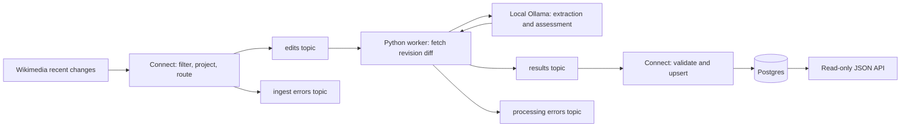

# Implementation plan

Date: 20 October 2026. Status: implementation plan with user-confirmed direction; exact model/version and capacity remain to be measured. This is engineering planning, not the candidate's required personal write-up.

## Scope and evidence

The assignment is preserved unchanged in [the original assignment file](assignment/fde-take-home-exercise.md), supplied by Damien. Use the [phase verification guide](phase-verification.md) to run and assess each completed checkpoint. His additional requirements are a simple, production-quality implementation, 100% unit-test coverage, phase documentation, a prompt/response log, and one branch/PR per phase into `main`.

Damien explicitly requested entirely new work and removal of previous repository history. Initialize a fresh main baseline, then open the planning PR. Do not restore, reuse, or describe earlier implementation as work completed for this build.

## Proposed product and minimal architecture

A human-review queue for substantive Wikipedia edits. Fetch the actual before/after revision diff. The model extracts changes in meaning and evidence, then assesses whether a reviewer should inspect them. It does not declare factual truth, infer editor intent, automatically revert edits, or substitute a label derived from the edit comment for content analysis.

Agreed stack: Python with typed data models and a small read-only API; Redpanda single-node development broker; Redpanda Connect; Ollama with an open-weights model chosen by a hardware/quality spike; Postgres 16. Use one repository and one Python package, run the worker and API as separate processes, and avoid agent frameworks or a separate frontend build. JSON is sufficient for the assignment; a small server-rendered review page is optional only if time remains.

Support two model backends behind one small typed interface: local Ollama and a hosted frontier model. Keep model name configurable rather than assuming a reviewer can run a particular model. Use a single supported hosted API contract initially; do not imply arbitrary providers are interchangeable. Choose and document the first hosted provider during Phase 1, then test its request/response contract as well as Ollama's.

Expose `LLM_BACKEND`, `LLM_MODEL`, the backend URL, timeout/token limits, and a hosted API key through documented configuration and `.env.example`. Never commit keys. Validate incompatible settings at startup. No silent provider fallback: a local failure must not trigger unapproved hosted spending or data transfer. Record backend, model, and prompt version with every analysis.

The README must provide two complete copy-paste paths: local mode with model initialization and measured hardware requirements, and hosted mode with an explicit provider/model/key and no mandatory local model download. Provide an external Ollama URL option for native host/GPU use, with container networking instructions. Use a Compose profile or documented override to omit local inference resources in hosted mode. Default `docker compose up` must still have a working documented local path. First-run downloads require internet; hosted mode also requires a provider account/key and may incur charges. Public data ingestion itself requires no signup.

Run deterministic provider contract tests without keys. Record at least one real smoke run per supported backend before declaring that backend verified; if credentials are unavailable, explicitly report hosted verification as pending. Both backends must obey the same schemas, retry/call budgets, and abstention behavior.

## Where Redpanda adds value

- Connect owns streaming ingestion, filtering, projection, routing, and the Postgres sink.
- Use Kafka-compatible topics to decouple ingestion, reasoning, and storage, permit replay, and inspect each boundary.
- Use `rpk` in the broker container for topic setup, production/consumption of fixtures, and consumer-lag inspection. A host installation is optional.
- Use Connect lint and its native configuration tests for Bloblang behavior. Do not place reasoning control flow or model-output recovery inside a Connect `branch`.
- Use only components verified as permitted by the assignment. No Redpanda Cloud, enterprise-only connectors, or `a2a_message`.

The brief contains a generic hint about using `branch` for model calls. Its explicit requirement that the multi-step reasoning live in application code controls this design.

## Processing contract

1. Connect accepts English Wikipedia article edits with valid old/new revision identifiers, drops heartbeats/bots/unwanted namespaces, and projects a versioned event keyed by wiki plus revision ID. Route malformed candidate events to an error topic. Intentionally filtered events are counted, not treated as failures.
2. Apply a documented deterministic sampling limit before inference. Size the accepted rate from measured model throughput; distinguish deliberate sampling from backpressure. Record counts so the demo does not imply complete firehose coverage.
3. The worker builds a request to an allowlisted MediaWiki endpoint using validated revision IDs, rather than following arbitrary event URLs. Fetch the diff and bounded surrounding revision context where necessary. Preserve before/after direction, text, provenance, and truncation status.
4. First model call extracts substantive changes with exact evidence excerpts. Second call assesses those changes against the diff and recommends `routine`, `review`, or `insufficient_evidence`, with a short evidence-based explanation. The application validates evidence spans and the schema. A model's self-reported confidence is a routing signal, not a calibrated probability.
5. Low-confidence or contradictory results take a bounded review path; malformed responses take a bounded repair path. Initial budget: at most four model calls per item including repair/review, plus a wall-clock deadline and token/output bounds. Tune the threshold on a development set, then evaluate a separate held-out set. Exhaustion produces an explicit insufficient-evidence or failed status, never a confident default.
6. Publish a validated result with event ID, source/diff link, schema version, model and prompt versions, evidence, decision, confidence signal, attempts, timing, and completeness flags. Publish unrecoverable technical failures to a separate error topic with a reason and replay metadata.
7. Commit the consumed offset only after the result or error publication is acknowledged. Start with sequential processing per partition so a later successful record cannot cause an earlier failed record to be skipped. Graceful shutdown drains or leaves work uncommitted.
8. Connect upserts results into Postgres using `(wiki, revision_id, analysis_version)` as the unique key. Broker delivery is at least once; duplicates and repeated inference can occur on replay. Do not claim exactly-once processing. Durable results must be idempotent; expose retryable/failed states and a deliberate replay path.
9. The API lists and retrieves persisted results with bounded pagination and filtering. Health reports process liveness separately from dependency readiness. Raw HTML is not rendered; external content remains untrusted throughout.

## Phases and branch policy

| Phase | Branch | Observable checkpoint |
|---|---|---|
| 0: plan | `phase/00-plan` | Requirements, phase contracts, test policy, interaction log |
| 1: foundation | `phase/01-foundation` | Broker, database, and selected model start; CI gate works |
| 2: ingestion | `phase/02-ingestion` | Connect turns fixture/live SSE into inspectable topic records |
| 3: enrichment | `phase/03-enrichment` | Revision IDs become bounded, traceable before/after content |
| 4: reasoning | `phase/04-reasoning` | Worker produces validated multi-step results and safe failures |
| 5: serving | `phase/05-serving` | Results persist and can be queried end to end |
| 6: acceptance | `phase/06-acceptance` | Clean startup, recovery drills, held-out evaluation, handover |

Build dependent phases in order. Normally create each branch from updated `main` after the previous PR is reviewed and merged. Do not open empty branches or include unfinished later phases just to create a PR. Keep PRs open for Damien unless he authorizes automatic merging. After the explicitly requested initial history reset, do not force-push or replace phase history. Keep every phase as a reviewable PR.

Each phase document records intended scope, actual changes, commands, expected results, observed results, limitations, and commit/PR links. A phase is complete only when its checks pass and its demonstration is understandable. Test commands listed in this plan are proposed interfaces, not commands already available.

## Production quality and limits

Require strict input/output schemas, safe configuration, pinned dependencies and container versions, timeouts, bounded work, retry/backoff, correct offset handling, idempotent persistence, structured logs, health checks, meaningful tests, and documented recovery. Keep the design small and direct.

The mandated single-node `dev-container` deployment is a local development deployment. It cannot demonstrate production high availability or operational readiness for an unspecified customer. The final release notes must state deployment assumptions and remaining work such as authentication, TLS, redundancy, backups, restore objectives, retention policy, and capacity. Do not certify the entire system as production-ready solely because unit coverage is 100%.

External SSE replay availability and gaps during disconnects must be measured and documented. Do not promise lossless ingestion from a public feed. Rate-limited/deleted/suppressed revisions and oversized content must be explicit outcomes.

## Confirmed decisions and schedule

Damien selected Wikipedia edit triage, Python, selectable local/hosted models, a fresh build with fresh history, and his own review/merge of each phase. The demo runs on his current machine; measure available memory and Docker resources in Phase 1. Reviewers' hardware is unknown, which is why hosted inference must be supported.

Deadline: Friday, 23 October 2026 (Europe/Dublin). Work must support interrupted sessions:

- Tuesday 20 October: planning review, foundation/model feasibility, and ingestion, subject to PR review turnaround.
- Wednesday 21 October: enrichment and reasoning, including failure-path tests and a first real-model evaluation.
- Thursday 22 October: persistence/API, full end-to-end tests, clean-start and recovery checks.
- Friday 23 October: buffer for fixes, final independent README writing, verification, and submission. Avoid new features.

These are sequencing targets, not a guarantee before feasibility and PR turnaround are known. Preserve required quality gates if time tightens; cut optional UI/presentation features first. Phase 1 records a realistic time estimate after the model/startup spike. Reserve at least the assignment's approximately 30 minutes for Damien's independent write-up, plus walkthrough practice.

At each pause, update the phase document with the branch, last tested commit, commands/results, open issue, and exact next step. Each session starts by reading that handover and repository status. Never assume an unmerged phase is present in main.

## Primary references checked during planning

- [Redpanda Connect overview](https://docs.redpanda.com/connect/home/)
- [Connect streaming HTTP input](https://docs.redpanda.com/connect/components/inputs/http_client/)
- [Connect native unit tests](https://docs.redpanda.com/connect/configuration/unit_testing/)
- [Connect enterprise licensing](https://docs.redpanda.com/connect/get-started/licensing/)
- [Redpanda local quickstart](https://docs.redpanda.com/streaming/current/get-started/quick-start/)
- [rpk topic consume](https://docs.redpanda.com/streaming/current/reference/rpk/rpk-topic/rpk-topic-consume/)
- [MediaWiki Compare API](https://www.mediawiki.org/wiki/API:Compare)

Exact component syntax, supported image architectures, model license, and pinned versions must be verified against the selected versions in Phase 1. These references support the plan; they are not evidence that a pipeline has been run.
