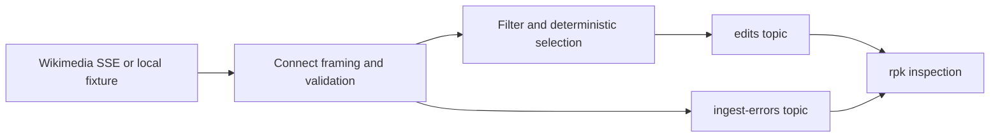

# Phase 02: Connect ingestion and routing

Status: implemented; awaiting Damien's PR review and merge.
Branch: `phase/02-ingestion`, from merged PR #5 at `cf2cf4c`.
Implementation and cleanup tested: `0b9e370`. Later commits add documentation/evidence only.

## What this phase adds

Redpanda Connect reads Wikimedia's recent-change stream, selects non-bot English Wikipedia article edits, validates their revision IDs and timestamps, and publishes the existing `EditEvent` contract to `edits`. Invalid records go to `ingest-errors`. No model, enrichment worker, result storage, or API is involved yet.



| File | Responsibility |
|---|---|
| `connect/ingest.yaml` | Actual HTTP input, framing, validation, filtering, projection, metrics, and native Redpanda output |
| `connect/ingest_test.yaml` | 40 native processor tests, including independent filter and sampling cases |
| `compose.infrastructure.yml` | Pinned Connect 4.114.0 and an optional local HTTP fixture server |
| `tests/fixtures/ingestion/` | Synthetic SSE examples and exact expected JSON, with provenance notes |
| `tests/test_ingestion.py` | Real HTTP → Connect → broker assertions, replay, CRLF, and malformed frames |
| `tests/test_live_ingestion.py` | Separate 30-second public-source smoke and sanitized evidence |
| `tests/conftest.py` | Unique disposable integration projects; strips inherited model/ingestion settings and credentials |
| `Makefile`, `.github/workflows/ci.yml` | Cumulative Phase 2 gate and retained Phase 1 gate |

The existing Python application is unchanged. Its 100% line/branch coverage remains mandatory; that percentage does **not** measure Connect YAML. Native tests and real broker assertions cover ingestion separately.

## Selection, contract, and errors

1. Recognize the observed Wikimedia event-first SSE profile. Join multiple `data:` lines and normalize CRLF to LF. Initial comments/control-only segments are ignored; malformed, ambiguous, truncated, or oversized candidate frames are rejected.
2. Require valid routing fields, then keep only `wiki=enwiki`, `type=edit`, `namespace=0`, `bot=false`. Unknown event types and irrelevant changes produce no broker record.
3. Require a nonblank title of at most 512 bytes, positive distinct integral revision IDs below 2^53, and an integral Unix timestamp from 0 through 253402300799. These conservative bounds avoid floating-point ID corruption and unsupported dates.
4. Default selection accepts `new_revision_id % 100 == 0`. This is deterministic selection of 1% of the eligible ID space, **not** a hard throughput cap or a guarantee of exactly 1% in a short window. `INGEST_SAMPLE_ALL=true` disables it for demonstrations. Other values retain the default.
5. Project only the six schema fields below. Build the key with decimal integer formatting, including large real-world IDs. Publish provenance as Kafka headers `source`, `source_id` (SSE ID, first 2,048 bytes), and `ingest_version=1`.

The first synthetic fixture output is exactly:

```json
{
  "schema_version": 1,
  "wiki": "enwiki",
  "title": "Example article",
  "old_revision_id": 100,
  "revision_id": 101,
  "occurred_at": "2026-10-20T10:00:00Z"
}
```

Its key is `enwiki:101`; its headers are `source=fixture`, `source_id=fixture-1`, `ingest_version=1`. The second fixture edit has key `enwiki:201`. Full expected payloads are in [expected-edits.json](../../tests/fixtures/ingestion/expected-edits.json).

Error records have `schema_version`, `stage=ingestion`, `reason=invalid_record`, `source`, bounded `source_id`, and `payload_sha256`. Their key is `ingest:<sha256 of original frame>`. The envelope excludes the raw payload and parser exception. Different line endings produce different error hashes; accepted edit keys remain identical. See [expected-error.json](../../tests/fixtures/ingestion/expected-error.json).

The output uses `acks=all`, idempotent producer writes, a single in-flight request, bounded buffering, and explicit topics created by `topics`. Replaying the source can still create duplicate records with stable keys; later processing/storage phases will own deduplication.

## Repeat the deterministic checks

Prerequisites: Docker running with Compose 2.20+, Make, uv 0.13.3, approximately 4 GiB available Docker memory. uv installs Python 3.13.16 if necessary. Initial image/dependency downloads require internet; the tests use a local fixture and no API keys or model downloads.

From the repository root:

```sh
make verify-phase-2
```

If your installed uv differs, use the exact version without changing your global installation:

```sh
make verify-phase-2 UV='uvx --from uv==0.13.3 uv'
```

Expected: 86 unit tests, 8 integration tests, 40 native Connect tests, zero missing/excluded application lines, zero missing branches, successful lint/types/configuration/container checks, and:

```text
PASS: Phase 2 ingestion checks. Live source smoke is a separate check.
```

The eight integration tests include the four Phase 1 checks (including the PostgreSQL maintenance upgrade) and four ingestion checks. Allow roughly one minute with cached images; first downloads/builds take longer. Reports are written to ignored `reports/` and uploaded by CI as `phase-2-test-reports`.

For focused checks:

```sh
make test-connect       # native processor tests and config lint; Docker only
make test-integration   # all 8 real infrastructure/ingestion tests
make test-unit          # 86 tests, 100% Python line AND branch coverage
make verify-phase-1     # still checks the foundation only
```

The HTTP integration test serves the six-segment [fixture](../../tests/fixtures/ingestion/README.md), disables selection, and consumes each **complete** topic with `rpk --offset :end`. Each run must add exactly two edits and one error; missing or extra records fail. It repeats the LF fixture and then the CRLF fixture: six edits and three errors in total, stable edit keys, exact fields, and exact provenance headers. Separate incomplete, unrecognized, and >64 KiB frames must add one error each and no edits. Native tests independently exercise filters, sampling, timestamps, type/bounds checks, and large revision keys.

Tests use unique `triage-test-*` projects, ephemeral diagnostic ports, and clean up only their own containers/volumes. Cleanup includes the optional fixture profile and asserts no resources for that project remain. They do not read your `.env`. Native lint/test and the container build may leave cached images and an empty default Compose network/volume declaration; they do not start live ingestion or remove demo data.

## Repeat the live demonstration

This is separate from CI because it needs the public Wikimedia endpoint. It makes **zero model requests** and temporarily selects all eligible edits in its own disposable project.

```sh
make smoke-ingestion
# With an older global uv:
make smoke-ingestion UV='uvx --from uv==0.13.3 uv'
```

It waits up to 30 seconds for readiness, observes 30 seconds of streaming, stops Connect, validates every produced edit against the Python schema/key contract, prints counts and up to three projected examples, and writes `reports/phase-2-live.json`. Individual Docker operations also have deadlines. Normal total runtime here was 38.44 seconds. Cleanup runs on success and failure. No particular live edit is required, but processing zero frames fails.

Observed on 20 October 2026: **789 processed segments** at the metrics snapshot: 25 accepted, 763 filtered, one heartbeat, zero invalid, zero sampled out. After graceful draining, the broker held **27 valid edits and zero errors**. The snapshot precedes shutdown, so the final topic count can be larger. Counter totals measure processed scanner segments before publication, not acknowledged writes or all source events. Raw user/IP fields are not committed. See [live evidence](../evidence/phase-2-live.json).

For an interactive run without loading a model, from your normal checkout:

```sh
docker compose -f compose.infrastructure.yml up -d redpanda topics connect
curl --fail http://127.0.0.1:4195/ready
curl --fail http://127.0.0.1:4195/metrics
docker compose -f compose.infrastructure.yml exec -T redpanda rpk topic consume edits --offset :end --format json --pretty-print=false
docker compose -f compose.infrastructure.yml exec -T redpanda rpk topic consume ingest-errors --offset :end --format json --pretty-print=false
docker compose -f compose.infrastructure.yml stop connect
```

Repeat the consume command later if default 1% selection has produced no edit yet. To inspect all eligible edits, set `INGEST_SAMPLE_ALL=true` in your untracked `.env` and recreate Connect; restore `false` when finished. If `CONNECT_PORT` differs, use that port in the URLs. Readiness and Prometheus metrics are exposed only on host loopback; broker/database ports remain internal. `docker compose -f compose.infrastructure.yml down` stops the manual stack while preserving data. Do not add `--volumes` to that command on a stack you want to keep.

## Evidence and test strength

The [verification record](../evidence/phase-2-verification.json) records the exact command, tested commit, versions, counts, coverage and limitations. Two checks demonstrated that the assertions detect real mistakes:

- The first live run found scientific notation in large revision keys. Added regression cases for `1381188467` and `9007199254740991`: both failed with the original conversion and pass with explicit decimal formatting. The corrected live run passes.
- In an isolated scratch copy, removing the bot filter made the native `filters bot` test fail on an unexpected output batch. The repository pipeline was never modified for this mutation. The full restored suite passes.

## Limits and troubleshooting

- This is deliberately a Wikimedia-specific SSE profile, not a general SSE client. The `re_match` scanner starts at `event:` lines and waits for the next event boundary or EOF before emitting. It supports observed LF/CRLF event-first framing and multiline data, with approximately one-event lookahead. Arbitrary SSE field ordering and bare-CR framing are unsupported. A changed upstream protocol needs investigation and updated fixtures.
- The supported frame bound is 64 KiB. The scanner has a separate 128 KiB cap; exceeding that cap fails at the input before processors can publish an error envelope. Inspect Connect logs/metrics for those source failures. Long idle connections have no application idle deadline: Connect's streaming HTTP implementation does not apply an ordinary request timeout to the open stream.
- HTTP reconnect is enabled with retry backoff; there is no durable `Last-Event-ID` checkpoint or gap-free recovery guarantee. Disconnects may lose events or replay them. Kafka producer idempotence does not make public-source ingestion exactly once. Recovery/throughput/load guarantees have not been established by this phase.
- If readiness fails, inspect `docker compose -f compose.infrastructure.yml logs connect redpanda topics`; check Docker memory, network access, and source availability. If port 4195 is occupied, choose a different `CONNECT_PORT`. The automated tests choose an ephemeral port.
- Fixture failures are deterministic: inspect the failing pytest assertion and compare it with the committed expected JSON. Native test failures show the input case and mismatched metadata/payload. Do not retry-until-green or weaken assertions to accommodate a bug.
- The deployment remains single-node development infrastructure. No model reasoning, production authentication/HA, downstream deduplication, or accuracy claim is introduced here.

Upstream references: [HTTP streaming input](https://docs.redpanda.com/connect/components/inputs/http_client/), [regex scanner](https://docs.redpanda.com/connect/components/scanners/re_match/), [native tests](https://docs.redpanda.com/connect/configuration/unit_testing/), [Redpanda output](https://docs.redpanda.com/connect/components/outputs/redpanda/), [Bloblang formatting](https://docs.redpanda.com/connect/guides/bloblang/methods/#format), [Wikimedia EventStreams](https://wikitech.wikimedia.org/wiki/EventStreams).

## Handover

Damien reviews and merges this PR. After merge and a new request, Phase 3 can consume these revision IDs and fetch bounded before/after revision evidence. The original assignment and Damien's independent README sections remain unchanged.
