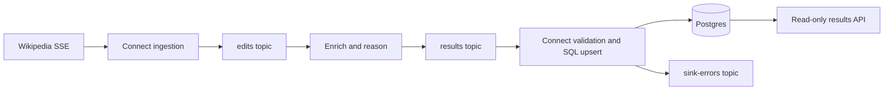

# Phase 05: Persistence and readable results

Status: implemented, verified locally and in Linux CI, and merged in [PR #9](https://github.com/damogallagher/redpanda/pull/9) as `c19565d`.
Branch: `phase/05-serving`, from merged PR #8 (`b80908b`). Damien reviews and merges.

## What changed

The source-to-result path now ends in Postgres and a read-only JSON API:



- `connect/sink.yaml` uses Redpanda Connect's `redpanda`, `json_schema`, `sql_raw`, and `retry` components. It checks the versioned schema, analysis key, event agreement, evidence/provenance consistency, and size limits. Invalid input becomes a small error record with its source position and SHA-256; it is never inserted as a normal result.
- `db/002-results.sql` creates `triage_results`, its unique `(wiki, revision_id, analysis_version)` key and query indexes. `db-migrate` applies it before the sink/API start, including on existing Phase 1 volumes. It uses a transaction, advisory lock, and idempotent DDL/marker. No database reset is required.
- The parameterized upsert preserves the row ID and creation timestamp. A higher result-topic offset can update an existing analysis; older/equal offsets cannot overwrite it. Replaying a consumer from the beginning therefore retains the most recent stored value. SQL failures retry with bounded backoff while leaving input unacknowledged; database outages do not become invalid-result errors.
- `src/triage/storage.py` uses parameterized queries and read-only connections with connect/query/lock timeouts. `src/triage/api.py` validates request bounds, returns sanitized failures, and serves evidence as JSON with `nosniff` and `no-store` headers. It makes no model calls.
- Both startup profiles include `db-migrate`, `sink`, and `api`. API port 8000 and sink diagnostics port 4196 bind to loopback. Existing private profiles inherit defaults; no new key is needed. Passwords are passed separately from SQL/URLs, including passwords containing URL punctuation.

## Repeatable verification

Prerequisites: Docker/Compose 2.20+, Make, uv 0.13.3, and this branch. Python 3.13.16 is selected automatically. Run from the repository root. Initial image/dependency downloads need internet; the deterministic checks need no Wikimedia access, model download, or API key.

```sh
make verify-phase-5 UV='uvx --from uv==0.13.3 uv'
```

This runs all earlier deterministic checks, 100% application line/branch unit coverage, real sink/database/API checks, native Connect ingestion/sink tests, container packaging, and fixture inspection. Reports are written under ignored `reports/`; CI uploads them. Expected last line:

```text
PASS: Phase 5 persistence and results API checks. Live model evaluation is separate.
```

For a short walkthrough:

```sh
make demo-results UV='uvx --from uv==0.13.3 uv'
```

`make test-e2e` runs the same four scenarios. `make test-serving` adds the API/storage unit tests. The fixture demo took about 48 seconds with cached images on the development Mac; allow a few minutes for the cumulative gate and longer for initial downloads.

| Scenario | What the test must observe |
|---|---|
| Seed, update, replay | Three decisions stored; two-item first page and one-item second page; exact detail/evidence; duplicate key leaves three rows; replay preserves the updated payload, ID and timestamps |
| Parameterization/migration | Quotes and SQL-like text remain data; schema survives; applying migration twice leaves one version-2 marker and retains data/version-1 timestamp |
| Invalid results | Malformed and oversized records reach `sink-errors` with exact digest; stored row count stays unchanged |
| Database outage and sink restart | Liveness stays 200; readiness/data return sanitized 503; committed offset stays 6; recovery advances it to 7 and stores the pending analysis once |
| Fixture end-to-end | Six-record SSE fixture yields two edits; the real worker performs extraction and assessment against deterministic HTTP doubles; API returns two `triage-v1` reviews with exact source IDs/evidence and two recorded steps |

The end-to-end run uses real Connect, Kafka, worker code, Postgres, and HTTP API. Only the external Wikipedia/model HTTP responses are doubles. The test explicitly verifies processing results and errors, not just successful container startup. It does not establish live model quality; Phase 4's development evaluation remains separate.

Tests create unique `triage-test-*` Compose projects with dynamic loopback ports and a synthetic password containing URL punctuation. Cleanup removes only those projects' containers, networks, and volumes and verifies removal. Existing user data and model weights remain untouched.

## Inspect results yourself without running a model

```sh
make seed-results
curl --fail 'http://localhost:8000/health/ready'
curl --fail 'http://localhost:8000/results?analysis_version=demo-v1&limit=2'
curl --fail 'http://localhost:8000/results/enwiki/101?analysis_version=demo-v1'
```

`seed-results` starts the sink/API and their prerequisites, then publishes three explicitly synthetic records from `tests/fixtures/serving/`. It does not start ingestion or inference; already-running services continue. It uses the selected Compose project/profile and retains its data. Allow a few seconds for asynchronous persistence. The script prints URLs using the actual configured API port.

Expected demo decisions: revision **101 = review**, **102 = routine**, **103 = insufficient_evidence**, all with version **demo-v1**. The detail includes `result.analysis`, `result.enrichment`, `result.extraction`, `result.steps`, `source_url`, and storage timestamps. For revision 101:

```json
{
  "decision": "review",
  "before": "An association was found.",
  "after": "A causal relationship was proved.",
  "model": "fixture-not-a-real-model",
  "analysis_version": "demo-v1"
}
```

This is a compact projection of the full detail, not the response envelope. Fixture revision IDs are synthetic and must not be presented as real Wikipedia model judgments. The source URL is constructed from the fixed Wikipedia domain and IDs, never accepted as an arbitrary link from a request. Repeating `make seed-results` updates the same three logical keys. `demo-v1` keeps them separate from real worker output (`triage-v1`).

## API contract

| Request | Result |
|---|---|
| `GET /health/live` | 200 `{"status":"alive"}` independent of the database |
| `GET /health/ready` | 200 `{"status":"ready"}` only with readable table and migration 2; otherwise 503 |
| `GET /results` | `items` summaries and `next_before_id` (null on the last page) |
| `GET /results/enwiki/101?analysis_version=demo-v1` | Full stored result, or 404 `{"error":"not_found"}` |
| `GET /openapi.json` or `/docs` | Generated API specification / interactive documentation |

List filters: `decision` (`routine`, `review`, `insufficient_evidence`), `analysis_version` (nonblank, at most 512 characters), `limit` (1–100, default 20), and `before_id` (positive signed bigint). Results are ordered by storage ID descending. Pass the returned cursor with the **same filters** to fetch the next page; updates retain their position. Concurrent inserts do not repeat earlier pages. This is not a multi-request snapshot: results may be updated while paging.

Detail version is a query parameter so slashes/quotes can be URL-encoded as data. Missing/invalid parameters return 422 `{"error":"invalid_request"}`; unknown list parameters are rejected. Database errors or invalid stored payloads return 503 `{"error":"storage_unavailable"}` without SQL, credentials, or reflected input. A missing migration marker returns `storage_not_ready`. Write methods return 405.

## Inspect storage and retry

```sh
docker compose exec postgres psql -U triage -d triage -c \
  'SELECT id, wiki, revision_id, analysis_version, decision, source_offset FROM triage_results ORDER BY id DESC LIMIT 10;'
docker compose exec redpanda rpk group describe triage-store-v1
curl --fail http://localhost:4196/ready
curl --fail http://localhost:4196/metrics
docker compose logs --tail=30 sink db-migrate api
```

Use `SINK_PORT` / `API_PORT` from your profile if changed. Sink metrics include `triage_sink_records` by `valid`/`invalid` outcome and consumer lag; counters count processing attempts, not unique stored rows. API readiness proves database availability, not that the sink has caught up. Use the group offset/lag and query the expected analysis key to establish delivery.

To replay retained results without rerunning inference, choose an unused sink group in the selected profile (for example `SINK_GROUP_ID=triage-store-replay-1`) and recreate only the sink:

```sh
docker compose --env-file .env.local up -d --no-deps sink
```

Use `.env.frontier` when that is the selected profile. This starts at the earliest retained result for the new group. Reusing that group resumes its committed position. Restore the normal group in the profile and repeat the same command afterward. A fresh group may produce duplicate quarantine messages, but results remain unique. The automated demo proves the same behavior without touching your project.

- API 404 immediately after publishing: allow the sink to catch up, check group lag and `sink-errors`.
- API 503: check Postgres health and `db-migrate` exit status. `docker compose run --rm db-migrate` safely reapplies the migration. Keep the original password when reusing an initialized database volume; changing the environment does not change an existing role's password.
- Sink cannot write: inspect its logs and database health. Restore Postgres; transient failures retry. If the sink exited, `docker compose start sink` resumes from committed offsets.
- Port conflict: change `API_PORT` or `SINK_PORT` in the selected private profile, then rerun its launcher. Do not publish the database/broker ports as a workaround.

Stop your demo while retaining data:

```sh
docker compose --profile tools down --remove-orphans
```

## Limits and dependency choices

This remains a single-node local deployment. The API is unauthenticated and loopback-only; internal Postgres traffic has no TLS. Connections enforce read-only transactions, but the local deployment shares the database role with migrations/writes. A real hosted deployment needs separate least-privilege roles, authentication/TLS, backups, retention/capacity planning and redundancy. These are not established by 100% unit coverage.

The replay guard assumes the configured **single `results` partition with stable topic history**. Partition 1+ is quarantined. Do not recreate the topic or expand its partitions while retaining this offset history; migrate to a new namespace/checkpoint design first. It protects against replay of older Kafka records, not a newly produced later result with different model output. Inference can still repeat after worker failures. Kafka/Postgres delivery is at least once with idempotent logical storage, not a distributed exactly-once transaction. Recovery requires retained Kafka records and durable Postgres storage.

Sink limit: 256 KiB per result, safe integer revision IDs up to 2^53−1, 512-character analysis versions. PostgreSQL cannot store NUL in JSONB text; NUL escapes (including literal escaped spellings conservatively matching the guard) are quarantined. The API returns validated JSON evidence, not an HTML review UI, and makes no truth or model-accuracy claim.

New direct dependencies are pinned: FastAPI 0.156.0, Uvicorn 0.54.0, and Psycopg/binary 3.3.6. Existing image/dependency pins remain unchanged. The lockfile includes transitive packages; the shared nonroot application image serves both worker and API. There is no ORM, migration framework, frontend, or additional model provider. The supported Starlette test client currently emits a deprecation notice about its HTTPX test transport; tests pass without suppressing it.

Primary references used: [Connect SQL parameters](https://docs.redpanda.com/connect/components/outputs/sql_raw/), [consumer acknowledgement and ordering](https://docs.redpanda.com/connect/components/inputs/redpanda/), [retry output](https://docs.redpanda.com/connect/components/outputs/retry/), [native tests](https://docs.redpanda.com/connect/configuration/unit_testing/), [Psycopg parameter binding](https://www.psycopg.org/psycopg3/docs/basic/params.html), [FastAPI query models](https://fastapi.tiangolo.com/tutorial/query-param-models/). Actual pinned-container tests establish compatibility.

## Verification record

Implementation commit [`1885c30`](https://github.com/damogallagher/redpanda/commit/1885c303ecc1de23eb725f20e7b3fb882c7bbb9c) passed the complete command above, exit 0:

- **371 unit tests, 25 integration/configuration tests, 72 native Connect tests** (40 ingestion, 32 sink); no failures or skipped selected checks.
- **946/946 executable Python lines and 242/242 branches covered**, 100%, with zero exclusions.
- Real migration, upsert/replay, source-to-API, quarantine, and database outage/restart checks passed. The outage kept the committed position at 6 and recovery advanced it to 7.
- Deliberately changing the pagination predicate from `<` to `<=` failed the real API test: page two incorrectly repeated revision 102. The change was restored and the cumulative gate passed.
- Original assignment SHA-256 still matches its provenance record. Documentation links checked: 132, none broken. No live or paid model calls.

The [verification JSON](../evidence/phase-5-verification.json) records counts, coverage and tested commit. The [stored-result/recovery example](../evidence/phase-5-serving.json) includes the complete synthetic detail response. [Linux CI passed](https://github.com/damogallagher/redpanda/actions/runs/39477227692) on `ce97ce2`, running the same cumulative gate; reports are in `phase-5-test-reports`. [PR #9](https://github.com/damogallagher/redpanda/pull/9) was merged during handover. Phase 6 remains separate. Damien's independent README sections are unchanged.

Local handover: the demo was verified in Damien's checkout on `phase/05-serving`; after PR #9 merged, the checkout was returned to merged `main`. The documented `make seed-results` command passed there, and the API at `http://localhost:8000` returned the three expected `demo-v1` decisions and full review evidence for revision 101. The selected `.env`, `.env.local`, and `.env.frontier` fingerprints/permissions are unchanged. The demo command started no inference.

Documentation closeout: [PR #10](https://github.com/damogallagher/redpanda/pull/10) records the final CI/local-demo evidence and visible messages completed after PR #9 merged; it changes no application files.
